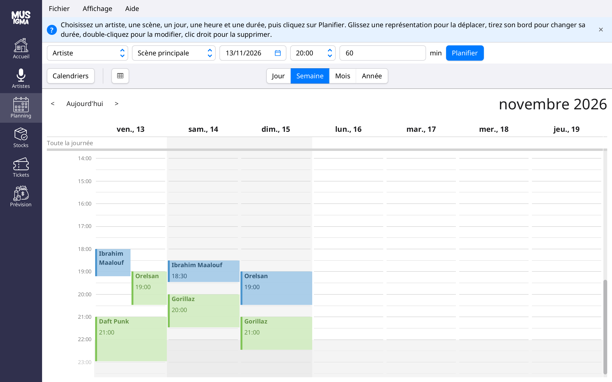

# Méga SAÉ – Musigma (groupe E1-06)

Projet de fin de première année de BUT Informatique (IUT2 Grenoble, avril à juin 2024) : une application de bureau
pour aider à organiser un festival de musique. Le sujet demandait un outil d'aide et de pilotage pour des organisateurs
d'événements, sous forme d'application avec interface graphique. On en a fait **Musigma**, en Java avec JavaFX.

La version rendue en juin 2024 est marquée par le tag [`rendu-code`](https://github.com/aravenad/musigma/tree/rendu-code). J'ai repris le projet seul
en octobre 2026 pour terminer les cas d'utilisation prévus et corriger les bugs.



## Ce qu'il y a dans l'application

Un fichier `.mgm` contient un festival entier. L'application est découpée en six espaces, un par cas d'utilisation
du dossier de conception :

- **Accueil** (UC1 Créer festival) : nom, dates, lieu, surface, prix de location et scènes
- **Artistes** (UC4.1 Engager artiste) : genres, cachets et représentations de chaque artiste
- **Planning** (UC4.2 Planifier représentation) : un calendrier par scène, où l'on déplace et allonge les
  représentations à la souris ; deux concerts ne peuvent pas se chevaucher sur la même scène
- **Stocks** (UC3.3 Modéliser stocks) : ressources limitées ou non, ce que les tickets en consomment et ce qui manque
- **Tickets** (UC3.1 Créer type de ticket) : prix, quantité, surface par personne et avantages pris dans les stocks
- **Prévision** (UC3.2 Simuler recettes) : bilan des recettes et des charges, et le nombre de tickets de chaque type à
  vendre pour gagner le plus (programmation linéaire en nombres entiers)

Il y a aussi un thème clair et un thème sombre, un zoom (Ctrl + / Ctrl - / Ctrl 0), une aide contextuelle sous la barre
de menus, des infobulles sur le menu de gauche et un guide d'utilisation qui s'ouvre avec F1.

## Lancer l'application

Il faut Java 17 ou plus récent. Le plus simple est de prendre l'application déjà construite,
[`genevent.jar`](out/artifacts/genevent_jar/genevent.jar), qui marche sous Windows, Linux et macOS Intel :

```bash
java -jar genevent.jar
```

Depuis les sources, il faut un JDK 17 ou plus récent ; Maven est fourni par le wrapper `mvnw`, rien d'autre à installer :

```bash
./mvnw javafx:run
```

Les préférences (fichiers récents, thème, zoom, aide) sont enregistrées dans le profil de l'utilisateur via
`java.util.prefs`. Les logs sont écrits dans le dossier temporaire (`musigma-*.log`) ; passer `com.musigma.level` à
`FINE` dans `src/main/resources/logging.properties` pour avoir le détail des modifications du modèle.

## Les autres commandes

| Commande | Rôle |
|---|---|
| `./mvnw test` | Tests unitaires (les tests JavaFX sont ignorés sans affichage) |
| `./mvnw test -Pbugs` | Tests des défauts connus, marqués `@Tag("bug")`, qui échouent tant qu'ils ne sont pas corrigés |
| `./mvnw compile spotbugs:check` | Analyse statique SpotBugs |
| `./mvnw pmd:check pmd:cpd-check` | Analyse statique PMD et détection de code dupliqué |
| `./mvnw javadoc:javadoc` | Javadoc dans `target/reports/apidocs` |
| `./mvnw -Pdist package` | Reconstruit `out/artifacts/genevent_jar/genevent.jar` |
| `python3 guide/generer.py` | Régénère le guide d'utilisation (F1) depuis `guide/guide.html` ; `--captures` refait aussi les captures d'écran (il faut Chrome et pdftotext) |

## Arborescence

```
├── pom.xml                    dépendances et plugins Maven
├── src/
│   ├── main/
│   │   ├── java/com/musigma/
│   │   │   ├── models/        le modèle : Festival, Artiste, Representation, Stock, TypeTicket, Bilan…
│   │   │   ├── controllers/   la fenêtre principale et les dialogues
│   │   │   │   ├── workspaces/    un contrôleur par espace (Accueil, Artistes, Planning…)
│   │   │   │   └── components/    les champs de saisie validés (texte requis, entier, décimal)
│   │   │   └── utils/         logs et préférences
│   │   └── resources/com/musigma/
│   │       ├── views/         les vues FXML
│   │       ├── styles/        la feuille de style
│   │       ├── images/        le logo et les icônes du menu
│   │       └── guide/         le guide d'utilisation en PDF
│   └── test/                  les tests JUnit 5
├── guide/                     les sources du guide et le script qui le génère
└── out/artifacts/genevent_jar/
    └── genevent.jar           l'application prête à lancer
```

## Nos choix

L'application suit une architecture **MVC** : le modèle dans `com.musigma.models`, les contrôleurs dans
`com.musigma.controllers` et les vues en FXML. `Festival` est la racine du modèle : toute modification qui touche
plusieurs objets passe par lui (planification, suppressions en cascade, modification d'un ticket, optimisation, bilan),
pour que les données restent cohérentes.

Le calcul de la vente optimale reprend notre rapport de méthodes numériques : maximiser la recette sous les contraintes
des stocks limités et de la surface du festival. Sur l'exemple du rapport (tickets VIP à 4 m², non VIP à 2 m²), il
trouve bien 205 000 €.

### Écarts avec le dossier de conception

| Dossier de conception | Réalisation | Raison |
|---|---|---|
| `Festival` singleton | Instance ordinaire, une par fenêtre | Testable, et ouvrir un autre festival remplace simplement l'instance |
| `Representation.startDate: LocalDateTime` | `decalageDebut` en minutes depuis le début du festival | Déplacer le festival déplace ses représentations |
| `Stock.absoluteQuantity: Integer \| null` | `quantite` + `limite` + quantité nécessaire calculée | L'écran Stocks a besoin d'une quantité prévue même pour un stock illimité (coût) |
| `TypeTicket.id` | Nom unique dans le festival | Le nom suffit à identifier un type de ticket pour l'utilisateur |
| Absent | `TypeTicket.surface`, `Festival.fin`, `Festival.scenes` | Surface par ticket du modèle mathématique (rapport R2.09) ; dates et scènes de l'UC1 |
| Contrainte de surface à 0,42 m²/personne | Surface propre à chaque type de ticket (0,42 m² par défaut) | Exemple du rapport : VIP 4 m², non VIP 2 m² → 205 000 € |

La réservation d'un emplacement de stand (UC2) et le choix des titres joués par un artiste (UC4.3) étaient en
priorité 3 dans le dossier de conception : ils ne sont pas réalisés.

## Équipe

ARAVENA BRAVO Damien (chef de projet), BENDRIS Naël, GIMBERT Bastien, GIBELLO Grégoire, BARTHES Cyril, MAILLET Lucas.

## Crédits

- Sujet : « Méga SAÉ » du département Informatique de l'IUT2 Grenoble (SAÉ S2.01, S2.02, S2.05 et S2.06)
- Interface : JavaFX, avec AtlantaFX pour les thèmes et CalendarFX pour le planning
- Optimisation : ojAlgo
